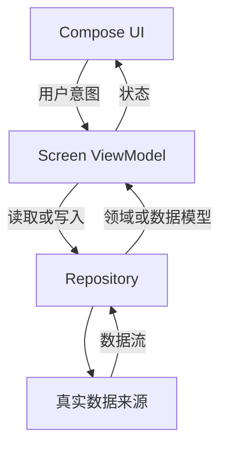

# Android 架构

状态：{{基于仓库事实重写；区分已实现、已选定未实现与待决策}}。

本文件描述当前仓库。不要把示例层次或依赖画成已存在模块；仅在项目含
多职责边界或重要数据流时生成。
若仓库使用 Views/XML，按现有 Activity、Fragment、ViewModel、导航与数据层
改写；删除 Compose 图及专属规则。Android/Kotlin 项目身份不构成迁移授权。

## 系统边界

- 产品职责：{{目标用户、核心任务与平台范围}}
- 应用入口：{{实际 Activity / Compose 根 / 导航入口}}
- 已存在模块：{{Gradle 项目与模块路径}}
- 外部服务与本地数据：{{真实服务、仓库、数据库、偏好及调用边界}}

## 状态与数据流

按实际代码绘图。仅在已采用或本次选定 Compose 时，以下流程才可作为待实现
基线：用户操作进入屏幕状态持有者，业务经 Repository 读取数据，新的 UI state
回到 Compose 界面。

生成项目文档时，将此图替换为真实类、边界、方向和证据；如果项目尚未实现，明确标注为“本次选定的计划结构”。对纯本地 UI 或简单工具，省略不适用的数据层。

- UDF：事件向下传递，数据状态向 UI 汇总；UI 不直接修改仓库数据。
- 有业务数据时经 Repository 隔离来源，即使只有一个数据源；纯本地 UI 不建空数据层。
- Domain/use case 仅在业务规则复杂、需复用或需隔离平台细节时增加，不为了层数齐全而引入。
- 离线优先、缓存策略、数据同步、账号与服务端所有权都须由产品和代码事实确定。

## 导航与模块边界

新 Compose 项目评估当前稳定 Navigation 3，以 typed key 表达目的地，并由
应用导航层持有返回栈和 deep link 规则。目标版本、restore 行为和多返回栈按
官方文档与真实依赖确定。既有 Navigation 2 项目可保留 NavController；迁移
需单独明确决定。

小型项目可从一个 app 模块起步，按职责组织源码。只有团队隔离、独立测试/复用、依赖方向或构建效率带来实际收益时再拆模块。多模块项目按实情记录：

- app 负责应用组装、入口和应用级导航。
- feature 模块持有单一业务功能；仅在跨 feature 导航或接口稳定性需要时拆分 API 与实现。
- core 模块承载多个功能真实共享的基础设施，不反向依赖 app 或 feature。
- 模块依赖保持单向，无循环；共享代码由依赖图和实际 Gradle 配置证明。

小型项目优先构造函数注入；规模增长后再根据依赖图与测试装配成本评估 Hilt。
Room、DataStore、网络、WorkManager 和分析均为条件技术，只有需求和仓库事实
支持时才写入。

## 架构来源

- [Android architecture recommendations](https://developer.android.com/topic/architecture/recommendations)
- [Compose architecture](https://developer.android.com/develop/ui/compose/architecture)
- [Now in Android architecture journey](https://github.com/android/nowinandroid/blob/main/docs/ArchitectureLearningJourney.md)
- [Now in Android modularization journey](https://github.com/android/nowinandroid/blob/main/docs/ModularizationLearningJourney.md)
- [Navigation 3 recipes](https://github.com/android/nav3-recipes)
